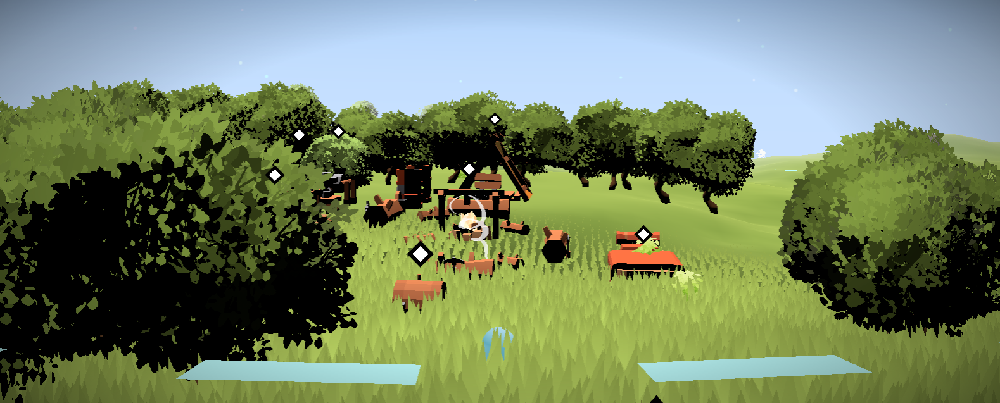
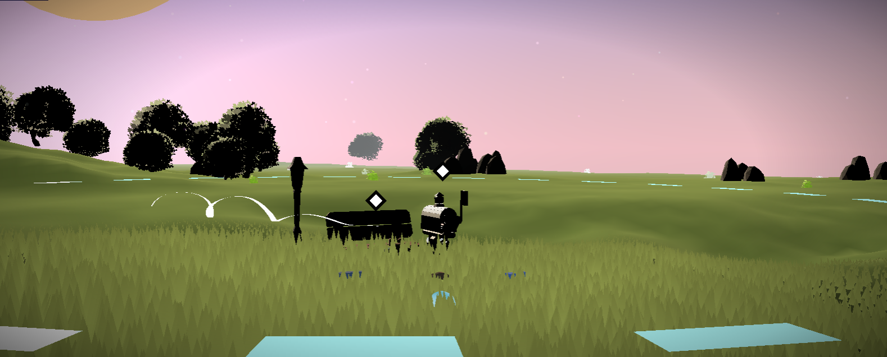
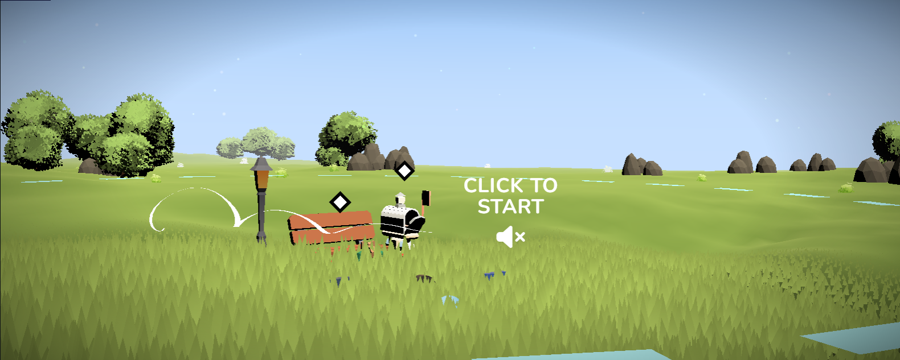

# Tiny Island

Tiny Island is a small interactive 3D world built with Three.js, TypeScript, and GLSL.

This was my first time building a project with Three.js. I started with a simple idea and, along the way, learned a lot about creating a 3D scene, working with shaders, and bringing different pieces of an experience together. Every project teaches you something new, and this island is a snapshot of that journey.

## A few views of the island







## Built with

- [Three.js](https://threejs.org/) for the 3D scene
- TypeScript for application code
- GLSL shaders for custom visual effects
- Vite for local development and production builds

## Run it locally

You’ll need Node.js and npm installed.

```sh
npm install
npm run dev
```

To check a production build:

```sh
npm run build
```

---

## Acknowledgments

I was inspired by Bruno Simon's creative 3D portfolio and studied how he organizes his code while learning to structure my own project. Thank you for sharing work that encouraged me to experiment with interactive 3D.

Made with love and care.
